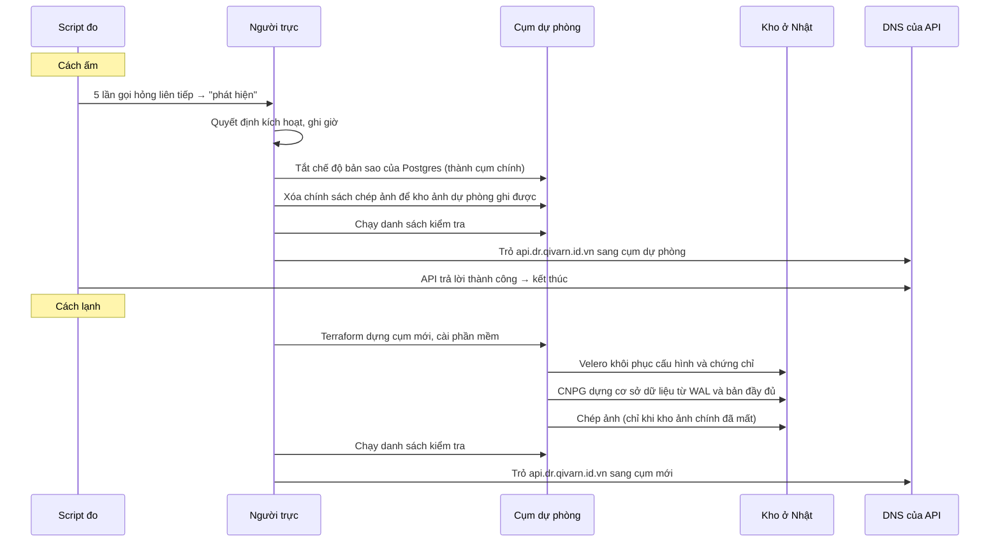

# Thiết kế hệ thống và kế hoạch diễn tập

Ngày 07/10/2026, sửa lần 1 cùng ngày sau buổi đánh giá, sửa lần 2 ngày 08/10/2026 để chốt hai việc cuối. Quang duyệt ngày 09/10/2026; bước tiếp theo là lập kế hoạch làm. Mọi phần code, hạ tầng, sao lưu và diễn tập đều làm theo tài liệu này. Muốn đổi gì thì sửa tài liệu này trước.

> Máy chạy Kubernetes: đã chốt ngày 08/10/2026, dùng k3s trên máy ảo, không dùng AKS. Theo tài liệu của Microsoft, nhóm máy hệ thống của AKS cần máy ít nhất 4 nhân, ít nhất 2 máy và không được dùng máy B-series. Tài khoản chỉ còn 4 nhân, nên không đủ cho hai cụm AKS đúng quy định. Mỗi cụm là một máy ảo B2als v2 cài k3s, chi tiết ở mục 1.

> **Phạm vi tối thiểu: đã chốt ngày 08/10/2026.** Đề yêu cầu phạm vi tối thiểu phải chạy được trên máy cá nhân, phòng máy hoặc gói miễn phí. Nhóm hỏi giảng viên ở buổi học 08/10 về việc chạy trên Azure for Students. Thầy trả lời: được, miễn là dùng môi trường cô lập.
>
> Thiết kế đáp ứng điều này như sau:
> - Đồ án chỉ dùng các nhóm tài nguyên riêng của mình (mục 1).
> - Đồ án không đụng tới tài nguyên của dự án khác trong cùng tài khoản.
> - Bản thu nhỏ ở mục 6.4 vẫn giữ. Bản này chạy được trên máy cá nhân và trên GitHub Actions miễn phí.

## 0. Mục đích và phạm vi

Câu hỏi nghiên cứu của đề tài 23: kế hoạch phục hồi có thực sự đạt mục tiêu về lượng dữ liệu được phép mất (RPO) và thời gian được phép ngừng (RTO) hay không, nếu chưa từng thử khôi phục?

Cách trả lời: dựng một web nhỏ đăng ảnh kèm mô tả, sao lưu theo kế hoạch, cố tình phá, khôi phục theo hướng dẫn (runbook), rồi đo bằng máy chứ không đoán. Làm ở hai môi trường:

- **Azure:** môi trường thật, có kho ở khu vực khác và có đổi DNS. Mỗi tình huống chạy 3 lần.
- **Bản thu nhỏ trên GitHub Actions** (mục 6.4): cùng web và cùng cách sao lưu, nhưng chạy trong một máy ảo của GitHub. Mỗi tình huống lặp 30 lần, miễn phí.

Hai bộ số đo được báo cáo riêng, không trộn với nhau.

So sánh hai chiến lược:

- **Cách lạnh (sao lưu và khôi phục):** chỉ dựng cụm mới khi có sự cố, rồi khôi phục từ bản sao lưu. Rẻ nhưng chậm.
- **Cách ấm (warm standby):** cụm dự phòng chạy sẵn và liên tục nhận dữ liệu. Tốn tiền hơn nhưng nhanh.

**Không làm:**
- chuyển ngược về cụm cũ sau sự cố (failback);
- chạy song song hai cụm cùng phục vụ (active-active);
- tính sẵn sàng cao bên trong một cụm (mỗi cụm chỉ có 1 máy).

### Giả thuyết cần kiểm chứng

| Mã | Giả thuyết | Đo bằng |
|---|---|---|
| H1 | Cách lạnh đưa web hoạt động trở lại trong 60 phút | Tổng 6 bước ở mục 5.2, các lần D2 và D4 |
| H2 | Cách ấm đưa web hoạt động trở lại trong 10 phút | Như trên, các lần D3 và D5 |
| H3 | Lượng dữ liệu mất không vượt RPO của từng thành phần (mục 3) | Bước kiểm tra ở mục 5.3 |
| H4 | Runbook chưa từng diễn tập sẽ có lỗi hoặc thiếu bước ở lần chạy đầu | Số chỗ phải sửa sau vòng thử |
| H5 | Khôi phục được từ két và từ bản ngoài Azure mà không cần kho ở Nhật | D7 |

Kết quả nào cũng là kết quả: giả thuyết bị bác bỏ thì báo cáo nêu lý do và điểm nghẽn.

## 1. Hệ thống chạy ở đâu

```
   Người dùng → https://dr.qivarn.id.vn  (giao diện tĩnh trên GitHub Pages)
                     │ gọi API
                     ▼
              https://api.dr.qivarn.id.vn  (DNS chuyển cụm, thời gian ghi nhớ 60 giây)
                     │
        ┌────────────┴─────────────┐
        ▼                          ▼
  Hàn Quốc – Cụm chính        Hàn Quốc – Cụm dự phòng
   web + Postgres              Cách lạnh: chỉ dựng khi có sự cố
   kho ảnh chính               Cách ấm: chạy sẵn, nhận dữ liệu liên tục
        │                          ▲
        │ sao lưu liên tục         │ khôi phục
        ▼                          │
  Nhật – Kho sao lưu ──────────────┘
  Nhật – Bản chép ảnh
  Nhật – Két chống xóa
        │ mỗi đêm server tự kéo về
        ▼
  Server dự phòng của một người bạn (ngoài Azure, nối qua Tailscale)

  GitHub (ngoài Azure): mã nguồn, image, kiểm tra sao lưu mỗi giờ,
  diễn tập lạnh mỗi ngày, bản thu nhỏ lặp 30 lần
```

| Nhóm tài nguyên | Khu vực Azure | Gồm |
|---|---|---|
| `rg-dr-primary` | `koreacentral` | Máy ảo chạy cụm chính (k3s), tài khoản lưu trữ ảnh chính |
| `rg-dr-standby` | `koreacentral` | Máy ảo chạy cụm dự phòng (k3s), tài khoản lưu trữ ảnh dự phòng |
| `rg-dr-backup` | `japanwest` | Bốn tài khoản lưu trữ: Terraform state, kho sao lưu (cơ sở dữ liệu, Velero), bản chép ảnh, két |

Khu vực và cỡ máy là tham số của Terraform, không viết cứng. Tài khoản sinh viên của người khác có thể được phép dùng những khu vực khác.

Lý do chọn như vậy:

- **Cả hai cụm ở Hàn Quốc:** tài khoản Azure for Students chỉ cho tạo máy ảo ở `koreacentral`. Tình huống "mất vùng" được giả lập bằng cách xóa toàn bộ nhóm `rg-dr-primary`.
- **Kho lưu trữ ở Nhật:** kho được phép đặt ở khu vực khác, nên bản sao lưu nằm thật ở Nhật.
- **Ảnh chép sang một tài khoản riêng:** tài khoản này phải bật lưu phiên bản (vì object replication). Tách ra để các bản sao lưu cơ sở dữ liệu đã hết hạn không bị giữ lại dưới dạng phiên bản cũ mà vẫn tốn tiền.
- **Không dùng MinIO** (đề gợi ý), vì bản cộng đồng đã ngừng phát triển. Azure Blob Storage có sẵn khóa chống xóa nên dùng luôn.
- **Công cụ:** hạ tầng viết bằng Terraform (đề gợi ý), cài phần mềm vào cụm bằng Helm. Image của web để trên GitHub Container Registry, tức là nằm ngoài Azure.
- **Cụm Kubernetes là k3s trên máy ảo, không dùng AKS:**
  - Mỗi cụm là một máy ảo B2als v2 (2 nhân, 4 GB) cài k3s. Hai cụm dùng đúng 4 nhân còn lại của tài khoản.
  - k3s được cài tự động ngay khi máy ảo vừa tạo xong (cloud-init trong Terraform). Phiên bản k3s ghim cố định.
  - Web nhận truy cập qua Traefik và ServiceLB có sẵn trong k3s. Hai thứ này mở thẳng cổng 80 và 443 trên IP công khai của máy, nên không cần bộ cân bằng tải của Azure.
  - Cổng quản trị (SSH 22, Kubernetes API 6443) chỉ mở cho địa chỉ IP của nhóm, khai trong Terraform. SSH chỉ đăng nhập bằng khóa.
  - Postgres lưu trên ổ đĩa của máy ảo. Mất máy là mất dữ liệu trên máy, đúng với tình huống cần diễn tập.
  - Nếu bước làm thử thấy thiếu RAM thì đổi sang B2as v2 (2 nhân, 8 GB). Máy này vẫn vừa 4 nhân.
  - Đổi lại, nhóm tự lo phần quản lý cụm, và báo cáo không có phần "dịch vụ Kubernetes do Azure quản lý".

Không dùng nhóm tài nguyên nào khác trong tài khoản. Tài khoản này còn có tài nguyên của một dự án khác, tuyệt đối không đụng tới.

**Tách DNS giao diện và API (chốt 08/10/2026):** `dr.qivarn.id.vn` trỏ CNAME tới GitHub Pages, tắt proxy, dùng cho trang giới thiệu và trang dùng. Chỉ `api.dr.qivarn.id.vn` trỏ vào cụm k3s và được đổi khi diễn tập. Chốt 24/10/2026 sau buổi chạy thử: bản ghi A của `api.dr.qivarn.id.vn` nằm ở Cloudflare (DNS của cả tên miền đã chuyển sang Cloudflare Free từ 09/10), tắt proxy, thời gian ghi nhớ 60 giây. Khi chuyển cụm, script gọi API của Cloudflare để đổi địa chỉ. Không dùng Azure DNS: không tốn thêm tiền và bớt một nơi có thể hỏng. Mã API Cloudflare chỉ có quyền sửa DNS của tên miền này, lưu trong secret của GitHub, không đưa vào kho. Giao diện vẫn tải được khi cụm chính mất, nên script đo phải gọi API để xác định khôi phục.

### Terraform state

Terraform state chứa khóa truy cập, nên không bao giờ đưa vào Git. State được lưu trong một tài khoản lưu trữ nhỏ riêng ở Nhật, có khóa chống ghi đồng thời. Tài khoản này được tạo trước bằng một lệnh khởi tạo riêng, không do Terraform quản lý.

## 2. Web

- **Công nghệ:** máy chủ (API) viết bằng Rust, trang web bằng Astro + Svelte. Đổi từ Python + FastAPI ngày 09/10/2026 vì Quang ưu tiên tối ưu hơn độ dễ: gói máy chủ nhỏ hơn và bật nhanh hơn nên cụm mới khôi phục nhanh hơn, tốn ít bộ nhớ hơn trên máy ảo 4 GB. Thiết kế chi tiết của web nằm trong bản thiết kế riêng cho web.
- **Chức năng:** đăng bài (tiêu đề, mô tả, một ảnh), xem danh sách, xem bài, tải ảnh.
- **Lưu trữ:** bài viết lưu trong Postgres, do CloudNativePG (CNPG) quản lý. Ảnh lưu trong Azure Blob.
- **Kiểm tra ảnh:** lúc đăng, web tính mã băm SHA-256 của ảnh rồi lưu vào bài viết.
- **Chống lạm dụng:** chỉ ai có mã bí mật mới đăng bài được. Mã này chỉ script đo và nhóm biết. Xem bài thì công khai. Ảnh tối đa 1 MB.
- **HTTPS:**
  - Giao diện trên GitHub Pages dùng chứng chỉ và chế độ bắt buộc HTTPS do GitHub quản lý. API dùng chứng chỉ Let's Encrypt, do cert-manager quản lý.
  - Let's Encrypt chỉ cấp tối đa 5 chứng chỉ cho cùng một tên miền mỗi 7 ngày. Vì vậy chứng chỉ chỉ xin một lần, sau đó được sao lưu và khôi phục cùng cấu hình. Cụm mới nhận lại chứng chỉ cũ, không xin mới.
  - Vòng thử dùng máy chủ thử (staging) của Let's Encrypt.
  - Bộ định tuyến HTTPS (ingress) là Traefik có sẵn trong k3s.
- **Kiểm tra web còn sống:** có `/healthz` để script đo gọi vào.
- Giao diện gồm hai trang riêng, làm theo thứ tự. Phần xử lý dữ liệu là một API JSON. Giao diện là trang tĩnh, gọi vào API đó. Hai trang tách riêng để trang dùng thật không phải tải phần 3D nặng.
  1. **Tuần 1–3, làm trước:** API, rồi trang dùng (xem danh sách, xem bài, đăng bài). Trang này phải dễ dùng, không gây khó chịu cho người dùng. Diễn tập chỉ cần chừng này.
  2. **Tuần 4–6, làm sau:** trang giới thiệu lấy phong cách từ apple.com (đổi từ alche.studio ngày 08/10; cả trang dùng cũng theo phong cách này). Trang có nút "Vào xem" sang trang dùng; lần sau vào thì đi thẳng tới trang dùng. Chỉ học ý tưởng, không lấy logo, phông SF Pro, hình ảnh, video hay câu chữ của họ. Trang giới thiệu vẫn có 3D, làm bằng Three.js: chỗ nào Apple dùng video quay sẵn thì mình dựng cảnh 3D bằng code, vì nhóm không tự làm được video (chốt 08/10). Cảnh 3D kể chuyện DR (chốt 08/10): ảnh từ cụm chính được chép sang két ở Nhật, cụm chính sập, dữ liệu từ két về cụm dự phòng và cụm này chạy lên. Mô hình (chốt 08/10): mọi thứ dựng bằng code, không dùng mô hình tải về, nên không cần tài khoản hay ghi công tác giả. Bản phác thảo đầu bị chê sơ sài, bản 2 bị chê có vật xuyên qua nhau nên trông giả. Bản dùng thật phải có chi tiết (tủ rack, khe ổ đĩa, cổng mạng, đèn, két sắt có cửa bản lề), ánh sáng studio, bóng đổ, sàn phản chiếu, và không vật nào xuyên qua vật nào: cảnh sập dùng mô phỏng vật lý tính sẵn, ảnh bay qua lỗ cửa két. Không gì được che chữ ở bất kỳ vị trí cuộn nào (bản 3 bị chê vì ảnh bay đè lên tiêu đề lúc chuyển cảnh); ảnh là ô bo góc bóng với phong cảnh vẽ bằng code, không phải hình minh họa. Ảnh ra vào tủ qua một khe nạp trên tầng trên cùng, đèn cạnh khe chớp đúng lúc từng tấm đi qua; không dùng quầng sáng lơ lửng làm điểm đến. Giao diện Apple thuần (chốt 08/10, sau khi so ba hướng): phông Be Vietnam Pro tải từ Google Fonts (phông hệ thống hiện thành Segoe UI trên Windows), nền đen, chữ căn giữa, chữ xám xen chữ trắng nổi bật; không chữ đơn cách, không ngoặc vuông, không hạt nhiễu. Lớp điều khiển (menu, nút, nhãn trạng thái, thanh chương kiểu iOS) làm bằng kính lỏng như Liquid Glass của Apple: khúc xạ ở mép, viền bắt sáng theo chuột, hiện ra bằng cách tăng dần độ khúc xạ; nhãn trên nền sáng dùng kính tối cho dễ đọc. Tiêu đề nhô lên từng từ khỏi lớp nhòe khi mỗi đoạn hiện ra và tan lên theo nhịp cuộn khi cuộn qua. Phần cuối trang là nhịp thứ năm ngay trong cảnh 3D (lùi ra toàn cảnh, nút kính "Vào xem"), không còn mảng phẳng tách rời. Nền và hiệu ứng chuột (chốt 08/10, học từ alche.studio): phía sau là bức tường ảnh của nhóm, tối cho tới khi đèn theo chuột rọi tới, kể chuyện cùng cảnh (sáng quét khi sao lưu, tắt khi sập, sáng lại khi khôi phục); rê chuột để lại vệt gợn như mặt nước trên cả khung hình. Tường dùng 48 phong cảnh tạo ngẫu nhiên, mỗi ô lật, cắt và đổi tông riêng nên không thấy lặp; sàn là sân khấu đen bóng, không xám. Hướng trừu tượng kiểu aether1.ai (mỗi cụm là quả cầu vòng sáng, ảnh là chấm sáng) đã thử và bị loại vì xấu và không liên quan tới máy chủ; cảnh phải là vật thật nhận ra được. Cảnh phải mượt (chốt 08/10): mỗi khung hình dưới 16 ms trên laptop phổ thông, chuột kéo máy quay trễ nhẹ chứ không giật theo, máy yếu thì tự bớt hiệu ứng (sàn phản chiếu, độ nét) thay vì giật. Nấc cuộn đầu tiên cảnh đã phải chuyển động, không có đoạn đứng yên ở đầu trang, nhưng cũng không được đi quá nhanh: mỗi nấc lăn chuột (100 px) chỉ đi khoảng 1/20 một đoạn. Nhãn trạng thái của tủ và két luôn nằm trong khung hình; trên điện thoại chỉ hiện nhãn của vật đang được nói tới. Trình đọc màn hình đọc nguyên câu tiêu đề, và người bật "giảm chuyển động" chỉ thấy chữ hiện ra và mờ đi.
  - Thiết kế chi tiết của giao diện chốt trong một bản thiết kế riêng cho web (đang làm từ 08/10).
  - Nếu không kịp làm trang giới thiệu thì nộp với trang dùng. Phần DR không phụ thuộc giao diện.
  - Giao diện là code nằm trong Git, nên không cần sao lưu. Script đo gọi thẳng API, nên giao diện nặng hay nhẹ đều không ảnh hưởng số đo.
  - **Bản xem thử công khai trước (chốt 08/10):** kho `dr-preview` chỉ chứa trang giới thiệu đã dọn công cụ đo, công bố bằng GitHub Pages. Nút cuối ghi "Vào xem · sắp có"; API và trang dùng chưa được triển khai. Kho đồ án chính giữ riêng tư. Khi làm API, cho phép giao diện gọi từ đúng nguồn `https://dr.qivarn.id.vn` bằng cấu hình CORS (quy tắc cho phép trình duyệt gọi sang nguồn khác).

## 3. Mục tiêu RPO và RTO

Đây là mục tiêu tạm. Trình tự đúng:
1. Lan Hương viết bản đánh giá ảnh hưởng (BIA) trong `danh-gia-anh-huong.md` trước ngày 14/10, dùng các con số dưới đây làm bản nháp.
2. Nhóm sửa con số nếu BIA cho thấy cần.
3. Chốt mục tiêu trước vòng diễn tập thử.

Diễn tập xong, báo cáo so số đo thật với mục tiêu.

| Thành phần | RPO | RTO cách lạnh | RTO cách ấm |
|---|---|---|---|
| Bài viết (Postgres) | 5 phút | 15 phút | 2 phút |
| Ảnh | 5 phút | 15 phút | 2 phút |
| Cấu hình Kubernetes | 1 giờ | 15 phút | 0 (đã có sẵn ở cụm dự phòng) |
| **Cả web, từ lúc sự cố tới lúc tên miền phục vụ lại** | | 60 phút | 10 phút |

RTO từng thành phần chỉ tính thời gian khôi phục thành phần đó. Các thành phần được khôi phục song song. RTO cả web cộng thêm thời gian phát hiện, quyết định, dựng hạ tầng và đổi DNS.

**Vì sao RPO đạt được:**
- Bài viết: nhật ký thay đổi (WAL) được gửi đi chậm nhất mỗi 1 phút.
- Ảnh: Azure tự chép, không cam kết độ trễ, nên phải đo (đo 24/10: p95 129 s).
- Cấu hình: Velero sao lưu mỗi giờ, còn file cấu hình gốc đã nằm trong Git.

Két và bản ở server bạn chỉ dùng khi mất kho ở Nhật hoặc mất cả tài khoản Azure. Hai nơi này không đặt mục tiêu RTO, chỉ cần chứng minh khôi phục được (D7).

## 4. Sao lưu

### 4.1 Cụm chỉ chạy khi làm việc, nên sao lưu chạy theo phiên

Để tiết kiệm, cụm chỉ tồn tại trong phiên làm việc hoặc diễn tập. Hết phiên thì xóa cụm, chỉ giữ các tài khoản lưu trữ. Vì vậy sao lưu không hẹn theo giờ trong ngày mà gắn với phiên:

| Lúc | Việc |
|---|---|
| **Bật phiên** | Dựng cụm; khôi phục cơ sở dữ liệu từ kho ở Nhật; khôi phục cấu hình và chứng chỉ |
| **Trong phiên** | WAL gửi liên tục, chậm nhất mỗi 1 phút. Velero mỗi giờ. Bản đầy đủ của cơ sở dữ liệu mỗi 6 giờ. Job két mỗi 24 giờ, nếu phiên kéo dài |
| **Trước mỗi lần diễn tập** | Bản đầy đủ của cơ sở dữ liệu và một bản Velero |
| **Tắt phiên** (bắt buộc, có script) | Bản đầy đủ, chờ xong → bản Velero → job két → ghi trạng thái "đã tắt" → xóa cụm |

Hệ quả có lợi: mỗi lần bật phiên là một lần khôi phục thật. Số lần và thời gian của những lần khôi phục này cũng được ghi lại, làm thêm bằng chứng cho báo cáo.

Mỗi lần dựng cụm mới, cơ sở dữ liệu ghi WAL vào một đường dẫn mới (tham số `serverName`), để không ghi lẫn vào lịch sử của cụm cũ. Đường dẫn đang dùng được ghi trong kho sao lưu để runbook đọc ra. Bước làm thử phải kiểm tra lại điểm này.

### 4.2 Sao lưu cái gì

| Dữ liệu | Cách làm | Giữ |
|---|---|---|
| Bài viết | CNPG + Barman Cloud Plugin gửi WAL và bản đầy đủ sang kho ở Nhật, `archive_timeout` = 1 phút | 7 ngày (`retentionPolicy: "7d"`). Khôi phục được về bất kỳ thời điểm nào trong khoảng đó |
| Ảnh | Azure Blob object replication: kho ảnh chính → bản chép ảnh ở Nhật. Có lưu phiên bản, nên ảnh bị xóa vẫn còn bản cũ ở Nhật | Phiên bản cũ tự xóa sau 7 ngày |
| Cấu hình Kubernetes, kể cả chứng chỉ HTTPS | Velero, lưu vào kho ở Nhật | 3 ngày; bản trước diễn tập và bản lúc tắt phiên giữ 7 ngày |
| Hạ tầng, file cấu hình, image | Git trên GitHub | Lâu dài |

**Không sao lưu:** log và số liệu giám sát. Cụm thì dựng lại bằng Terraform; bản ghi DNS ở Cloudflare do script chuyển cụm sửa.

**Lưu ý khi khôi phục bằng Velero:** không để Velero khôi phục đối tượng `Cluster` của CNPG và ổ đĩa của Postgres. Nếu để Velero làm, CNPG sẽ dựng một cơ sở dữ liệu rỗng. Cơ sở dữ liệu luôn được khôi phục bằng CNPG từ kho ở Nhật.

### 4.3 Ba tầng bản sao (quy tắc 3-2-1)

**1. Kho ở Nhật** (gồm kho sao lưu và bản chép ảnh). Dùng cho mọi lần diễn tập. Mất tối đa khoảng 1 phút bài viết.

**2. Két chống xóa.** Một tài khoản lưu trữ riêng ở Nhật, đặt chính sách "ghi một lần, không sửa, không xóa" (WORM) trong 7 ngày.

Job két chạy lúc tắt phiên, và mỗi 24 giờ nếu phiên kéo dài. Mỗi lần chạy, job gói ba thứ vào một gói:
- bản xuất `pg_dump`;
- các ảnh mới;
- bản Velero mới nhất.

Sau đó job mã hóa gói bằng `age` rồi tải lên két:
- Gói được mã hóa cho hai khóa, khóa nào cũng mở được:
  - khóa của Quang, để ngoài Azure (mục 4.4);
  - khóa riêng cho bài diễn tập hằng ngày trên GitHub (mục 4.6).
- Khóa công khai dùng để mã hóa thì nằm trong cụm.
- Job dùng mã truy cập (SAS) chỉ có quyền tạo mới, không có quyền ghi đè hay xóa. Đã lọt mã truy cập của cụm cũng không xóa được két.

RPO của két: tính tới lần tắt phiên gần nhất, hoặc tối đa 24 giờ.

Về chính sách khóa:
- Trong lúc làm, chính sách để ở trạng thái chưa khóa cứng. Trạng thái này vẫn chặn xóa, chỉ là quản trị viên còn sửa được chính sách.
- Trước vòng diễn tập chính thức thì khóa cứng. Sau khi khóa cứng, phải đợi hết 7 ngày mới xóa được két.

**3. Server dự phòng ngoài Azure (làm thêm).** Mỗi đêm server tự kéo các gói mới trong két về, dùng mã chỉ đọc. Restic giữ 7 bản theo ngày, dùng tối đa 3 GB ổ cứng.

Các gói đã được mã hóa bằng `age` từ trước, mà khóa giải mã không nằm trên server. Vì vậy người có quyền trên server cũng không đọc được dữ liệu.

Tầng này phòng trường hợp mất cả tài khoản Azure. Server tự kéo về, vì muốn cụm Azure đẩy sang thì phải cài thêm Tailscale vào cụm.

**Vì sao tầng 2 và 3 lưu bản xuất, không lưu WAL:**
- Mỗi file WAL được gửi với đủ kích thước dù chỉ chứa ít dữ liệu, nên gửi mỗi phút sẽ tốn chỗ. Bản xuất chỉ vài MB.
- Bản xuất khôi phục được vào bất kỳ Postgres nào, không phụ thuộc CNPG.

### 4.4 Mã hóa, quyền và chìa khóa

**Mã hóa trên đường truyền:**
- HTTPS khi làm việc với Azure và cho người dùng web.
- Tailscale (WireGuard) khi tới server bạn.

**Mã hóa lúc lưu:**
- Azure Storage luôn tự mã hóa (AES-256).
- Các gói trong két và ở server bạn được mã hóa thêm bằng `age`, ngay trước khi rời khỏi cụm.

**Quyền tối thiểu.** Mỗi thành phần dùng một mã SAS riêng, chỉ đúng quyền cần:

| Thành phần | Quyền |
|---|---|
| Web | Đọc và ghi kho ảnh |
| CNPG và Velero | Ghi kho sao lưu |
| Job két | Chỉ tạo mới |
| Server bạn | Chỉ đọc két |
| Job kiểm tra trên GitHub | Chỉ liệt kê và đọc kho sao lưu |
| Diễn tập lạnh hằng ngày trên GitHub | Chỉ đọc kho sao lưu, bản chép ảnh và két |

**Chìa khóa khôi phục** nằm trong trình quản lý mật khẩu của Quang, không để trên Azure, không đưa vào Git. Gồm:
- mật khẩu Postgres;
- khóa bí mật `age`;
- mật khẩu restic;
- các mã truy cập.

Mất cả Azure vẫn còn chìa để mở bản ở server bạn. Runbook ghi chìa nào nằm ở đâu, không ghi bản thân chìa.

Các mã chỉ đọc và khóa `age` dành cho GitHub được để trong mục Secrets của kho GitHub, không bao giờ nằm trong file. Đánh đổi: ai có quyền quản trị kho GitHub thì đọc được bản trong két. Dữ liệu là giả nên chấp nhận được, và báo cáo nêu điểm này.

### 4.5 Theo dõi sao lưu

Sao lưu hỏng mà không ai biết là rủi ro lớn nhất của một kế hoạch DR. Vì vậy, một workflow GitHub Actions chạy mỗi giờ, nằm ngoài Azure và không phụ thuộc cụm. Workflow đọc kho ở Nhật bằng mã chỉ đọc và kiểm tra:

| Kiểm tra | Ngưỡng báo lỗi |
|---|---|
| File WAL mới nhất | Cũ hơn 5 phút |
| Bản Velero mới nhất | Cũ hơn 2 giờ |
| Job két lần gần nhất | Không thành công |
| Mã truy cập SAS (ngày hết hạn ghi vào một file trạng thái lúc tạo mã) | Còn dưới 7 ngày là hết hạn |

- Lúc phiên đã tắt (trạng thái "đã tắt"), workflow chỉ kiểm tra hai điều: lúc tắt phiên đã có đủ bản đầy đủ, bản Velero và bản trong két, và mã truy cập chưa sắp hết hạn.
- Kiểm tra thất bại thì workflow báo lỗi, GitHub gửi email cho Quang.
- Mỗi lần kiểm tra ghi một dòng vào CSV, làm số liệu cho báo cáo.

### 4.6 Diễn tập lạnh tự động mỗi ngày

Mỗi ngày một workflow GitHub Actions khôi phục thử bản sao lưu thật vào một máy ảo của GitHub. Máy này bị xóa sau khi chạy xong. Việc này không tốn tiền máy Azure, và vẫn chạy cả những ngày cụm đã tắt.

1. Dựng một cụm kind trong máy của GitHub.
2. Khôi phục từ kho ở Nhật:
   - CNPG dựng cơ sở dữ liệu từ WAL và bản đầy đủ;
   - Velero khôi phục cấu hình ở chế độ chỉ đọc;
   - web đọc ảnh thẳng từ bản chép ảnh.
3. Giải mã gói mới nhất trong két rồi khôi phục vào một Postgres riêng.
4. Chạy bước kiểm tra ở mục 5.3, so với số bài và mã băm ghi lúc tắt phiên gần nhất.
5. Ghi thời gian từng bước vào `data/hang-ngay/`. Lỗi thì GitHub gửi email.

Bằng cách này, cả tầng 1 lẫn tầng 2 đều được thử khôi phục thật mỗi ngày. Đây đúng là điều câu hỏi nghiên cứu muốn kiểm chứng.

## 5. Đo thời gian và kiểm tra dữ liệu

### 5.1 Script đo

Chạy trên laptop suốt buổi diễn tập:

- **Kiểm tra web sống:** mỗi giây gọi `https://api.dr.qivarn.id.vn/healthz`, đồng thời gọi thẳng vào từng cụm. Nhờ vậy tách được lúc API sống lại khỏi lúc DNS đổi xong; trang tĩnh trên GitHub Pages không được dùng làm tín hiệu khôi phục cụm.
- **Điểm đối chứng:** mỗi giây gọi thêm một địa chỉ ổn định bên ngoài. Giây nào mạng ở nhà mất kết nối thì đánh dấu, và loại khỏi phép tính.
- **Đăng bài:** mỗi giây đăng một bài có số thứ tự kèm một ảnh nhỏ tạo ngẫu nhiên. Bài nào web xác nhận đã nhận thì script ghi lại số thứ tự, giờ và mã băm của ảnh.
- **Phát hiện sự cố:** gọi hỏng 5 lần liên tiếp thì ghi sự kiện "phát hiện".
- **Đồng hồ:** mọi mốc thời gian đều lấy theo giờ UTC của laptop. Laptop đồng bộ giờ trước mỗi buổi.

### 5.2 Sáu bước đo

Đúng như đề yêu cầu. Mỗi bước trong runbook là một lệnh tự ghi giờ bắt đầu và giờ kết thúc vào CSV.

1. Phát hiện
2. Quyết định kích hoạt khôi phục
3. Dựng hạ tầng
4. Khôi phục dữ liệu
5. Kiểm tra
6. Chuyển lưu lượng (đổi DNS cho tới khi tên miền trả lời thành công)

Minh Thư bấm giờ tay song song, để đối chiếu với số máy ghi.

### 5.3 Kiểm tra sau khôi phục

Danh sách chi tiết nằm ở `checklist-khoi-phuc.md`, do Minh Thư soạn từ mục này.

- **Số bản ghi:** so danh sách bài script đã ghi nhận với cơ sở dữ liệu.
  - Bài thiếu cho biết RPO thật, tính bằng khoảng từ bài cuối còn lại tới lúc sự cố xảy ra.
  - Bài thiếu nằm ngoài mục tiêu RPO được liệt kê riêng.
- **Mã băm:** tải từng ảnh về, so với mã lưu trong bài và mã script đã ghi. Ghi lại ảnh hỏng và bài còn mà mất ảnh.
- **Chức năng:** đăng bài, xem bài, tải ảnh lên. Bài thử không bị xóa (web không có lệnh xóa, xem `thiet-ke-web.md`): script ghi nhận nó như mọi bài khác, và trạng thái được dựng lại sau mỗi lần diễn tập.

Toàn bộ kết quả lưu thành CSV/JSON trong `data/<mã lần diễn tập>/`. `scripts/` có script vẽ lại biểu đồ. Mọi biểu đồ ghi rõ tên trục, đơn vị, điều kiện đo và số lần lặp.

### 5.4 Giữ điều kiện đo giống nhau giữa các lần

- **Cùng lượng dữ liệu:** trước mỗi lần diễn tập, đưa dữ liệu về đúng một bộ mẫu cố định, 1.000 bài, mỗi bài một ảnh khoảng 200 KB. Nếu không làm vậy, dữ liệu tăng dần qua các lần sẽ làm thời gian khôi phục trôi theo.
- **Cùng tải:** suốt lúc đo, script đăng đúng 1 bài mỗi giây.
- **Lần không báo trước:** trong vòng chính thức có ít nhất một lần Minh Thư tự phá vào một lúc ngẫu nhiên trong buổi, không báo trước cho Quang. Có vậy thì bước "phát hiện" và "quyết định" mới phản ánh đúng thực tế.
- **Cách báo cáo số liệu:**
  - Trên Azure mỗi tình huống chạy 3 lần, nên chỉ báo nhỏ nhất, trung vị và lớn nhất, không suy luận thống kê.
  - Bản thu nhỏ lặp 30 lần, nên báo trung vị và khoảng tứ phân vị, kèm cấu hình máy GitHub của từng lần chạy.
- **Nhiễu không loại trừ được:**
  - Kết quả vòng thử so với vòng chính thức lẫn cả hiệu ứng "quen tay", không chỉ do runbook được sửa.
  - Máy B-series có cơ chế tín dụng CPU. B2als v2 chạy nền ở 30% sức máy, máy mới dựng chỉ có 60 tín dụng để chạy vượt mức. Vì vậy máy mới dựng và máy chạy lâu có thể chạy nhanh chậm khác nhau. Script đo ghi lại số tín dụng còn lại lúc bắt đầu mỗi lần.

  Báo cáo nêu cả hai điều này trong phần giới hạn.

## 6. Diễn tập

| Mã | Tình huống | Chiến lược | Cách phá |
|---|---|---|---|
| D1 | Xóa nhầm namespace của web | Khôi phục ngay trên cụm chính, đưa cơ sở dữ liệu về thời điểm ngay trước lúc xóa | `kubectl delete namespace` |
| D2 | Mất cụm chính | Lạnh. Kho ảnh chính vẫn còn nên dùng lại, không cần chép ảnh | Xóa cụm chính |
| D3 | Mất cụm chính | Ấm | Xóa cụm chính |
| D4 | Mất nhóm tài nguyên chính (giả lập mất vùng) | Lạnh. Chép ảnh từ bản chép ở Nhật | Xóa cả nhóm `rg-dr-primary` (cụm và kho ảnh chính) |
| D5 | Mất nhóm tài nguyên chính (giả lập mất vùng) | Ấm | Như D4 |
| D6 | Thử xóa két | — | Dùng khóa tài khoản để xóa và ghi đè một file trong két. Kết quả đúng là bị từ chối |
| D7 | Khôi phục từ két và từ server bạn | — | Giải mã gói trong két rồi khôi phục vào một namespace thử. Khôi phục từ bản ở server bạn vào Postgres chạy trên laptop, để chứng minh không cần Azure. Sau đó chạy bước kiểm tra ở mục 5.3 |

Trình tự hai cách chuyển được vẽ ở mục 6.1.

**Giới hạn của D4 và D5:** hai cụm cùng ở `koreacentral` (mục 1), nên D4 và D5 chứng minh khôi phục được khi mất cả cụm chính lẫn kho ảnh chính, với dữ liệu lấy thật từ Nhật. Chúng không chứng minh hệ thống chịu được mất vùng thật: mất cả `koreacentral` thì cụm dự phòng của cách ấm cũng mất theo. Báo cáo nêu rõ điều này, và ước tính chi phí của cách ấm thật cho mất vùng, tức cụm dự phòng đặt ở vùng thứ hai.

**Hai vòng:**
- **Vòng thử:** D1–D7, mỗi tình huống một lần. Sửa runbook sau mỗi lần.
- **Vòng chính thức:** D1–D5 mỗi tình huống 3 lần; D6, D7 mỗi tình huống một lần. Có ít nhất một lần không báo trước (mục 5.4).
- Ít nhất một lượt chính thức do Lan Hương hoặc Minh Thư tự làm theo runbook, trên máy của Quang, Quang chỉ đứng xem.

**Sau mỗi lần diễn tập:** dựng lại trạng thái ban đầu bằng script, gồm cả bộ dữ liệu mẫu.

**Phân công:** Quang chạy lệnh, Minh Thư bấm giờ và ghi biên bản (`docs/dien-tap/`), script đo tự ghi phần còn lại.

### 6.1 Trình tự chuyển dự phòng



Ở cách ấm, Postgres ở cụm dự phòng là một cụm bản sao (replica cluster) của CNPG, liên tục đọc WAL từ kho ở Nhật. Kho ảnh dự phòng nhận ảnh liên tục bằng object replication. Một tài khoản nguồn chép được sang tối đa hai tài khoản đích: bản chép ảnh ở Nhật và kho ảnh dự phòng.

### 6.2 Quyền kích hoạt và báo tin

- **Ai được quyết định kích hoạt khôi phục:**
  - Quang quyết định.
  - Quang không liên lạc được trong 15 phút thì Lan Hương quyết định.
  - Người quyết định ghi giờ bằng lệnh của bước 2.
- **Báo tin:** runbook có sẵn ba mẫu tin nhắn gửi vào nhóm Zalo: "bắt đầu sự cố", "đã chuyển sang dự phòng", "đã khôi phục xong". Mỗi tin ghi giờ gửi.
- Làm thêm nếu kịp: nút kích hoạt khôi phục trên GitHub.
  - Runbook chạy được từ một workflow, không cần laptop của Quang.
  - Phải có Quang hoặc Lan Hương bấm duyệt thì workflow mới chạy. GitHub tự ghi lại ai bấm, lúc nào.
  - GitHub đăng nhập Azure bằng OIDC, không lưu mật khẩu.
  - Tài khoản của Quang đủ quyền thiết lập việc này (đã kiểm tra ngày 07/10).

### 6.3 Kế hoạch kiểm thử lại

- **Sau vòng chính thức:** lần nào trượt mục tiêu thì sửa điểm nghẽn, rồi chạy lại đúng tình huống đó một lần.
- **Trên bản nghiệm thu:** trước khi gắn thẻ phiên bản cuối, chạy lại D1 và D3 trên đúng bản đó.
- **Khi có thay đổi:** đổi phiên bản công cụ, hạ tầng hoặc runbook thì chạy lại các tình huống bị ảnh hưởng.
- **Nếu vận hành thật:** báo cáo đề xuất diễn tập lại mỗi quý, kèm lý do.
- **Tự động:** diễn tập lạnh mỗi ngày (mục 4.6) chính là kiểm thử định kỳ chạy tự động.

### 6.4 Bản thu nhỏ trên kind

Một script dựng toàn bộ thí nghiệm trong một máy duy nhất:
- hai cụm kind, đóng vai cụm chính và cụm dự phòng;
- SeaweedFS làm kho lưu trữ, thay cho Azure Blob;
- cùng web, cùng CNPG và Velero, cùng script đo và kiểm tra.

Chỗ khác với Azure chỉ là cấu hình kho lưu trữ, tách thành hai bộ cấu hình riêng (Kustomize overlay). Chạy được ở hai nơi:

- **Máy cá nhân có Docker:** đây là phạm vi tối thiểu mà đề yêu cầu, ai cũng chạy lại được.
- **GitHub Actions:** máy 4 nhân, 16 GB RAM, miễn phí vì kho công khai. Mỗi lần chạy tối đa 6 giờ, nên 30 lần lặp được chia thành nhiều job chạy song song.

Bản thu nhỏ chạy được D1, D2, D3 (cách ấm dùng cụm bản sao trong kind thứ hai) và D6 (thử xóa két bằng khóa chống xóa của SeaweedFS). Phải dùng bản SeaweedFS đã sửa lỗi khóa chống xóa (09/2026).

Bản thu nhỏ không có:
- mất vùng thật;
- đổi DNS;
- object replication của Azure.

Vì vậy D4, D5 và bước chuyển lưu lượng chỉ đo trên Azure. Máy GitHub dùng chung nên tốc độ dao động. Đây là lý do phải lặp nhiều lần, và số đo trên máy GitHub không được so trực tiếp với số đo trên Azure.

Điều khoản của GitHub chỉ cho dùng máy Actions để build, kiểm thử, triển khai và phát hành phần mềm của kho. Vì vậy máy GitHub chỉ dùng để thử nghiệm, không bao giờ phục vụ người dùng thật.

## 7. Chi phí

Giá bán lẻ Azure tại `koreacentral` và `japanwest`, đọc ngày 07/10/2026, đơn vị USD.

| Hạng mục | Đơn giá | Lượng ước tính | Thành tiền |
|---|---|---|---|
| Máy ảo cho cụm, B2als v2 (2 nhân, 4 GB) | 0,0468 / giờ | 120 giờ-cụm | 5,6 |
| Ổ đĩa hệ điều hành P4 (32 GB) | 5,28 / tháng ≈ 0,0072 / giờ | 120 giờ-cụm | 0,9 |
| Một địa chỉ IP công khai mỗi cụm | 0,005 / giờ | 120 giờ | 0,6 |
| Lưu trữ Blob | 0,02 / GB-tháng | khoảng 20 GB × 2 tháng | 0,8 |
| Thao tác ghi Blob | 0,05 / 10.000 lần | khoảng 200.000 lần | 1,0 |
| DNS (Cloudflare Free) | 0 | | 0 |
| Truyền dữ liệu Hàn Quốc → Nhật (WAL, ảnh) | 0,08 / GB | khoảng 10 GB | 0,8 |
| Dữ liệu ra internet (GitHub tải bản sao lưu mỗi ngày) | 100 GB đầu mỗi tháng miễn phí, sau đó 0,12 / GB | khoảng 15 GB / tháng | 0 |
| **Tổng** | | | khoảng 10 |

Buổi chạy thử 24/10 đo RAM đỉnh 46%, nên giữ B2als v2.

**Cách tính 120 giờ-cụm:** khoảng 75 giờ lúc làm (cụm chính 50 giờ, cụm dự phòng 25 giờ) và khoảng 45 giờ cho 24 lần diễn tập (7 lần vòng thử, 17 lần vòng chính thức).

### 7.1 Chi phí sẵn sàng của từng chiến lược

Phần này phục vụ việc chọn chiến lược. Giả sử web chạy thật cả tháng (730 giờ):

| Chiến lược | Phải trả thêm để sẵn sàng | Ước tính / tháng |
|---|---|---|
| Cách lạnh | Chỉ lưu trữ bản sao lưu | khoảng 1 USD |
| Cách ấm | Một cụm dự phòng chạy suốt (máy, ổ đĩa và IP, khoảng 0,059 / giờ × 730 giờ) cộng lưu trữ | khoảng 44 USD |

**Tiêu chí chọn:** BIA cho biết web ngừng một giờ thì thiệt hại bao nhiêu. Thiệt hại lớn hơn khoảng 44 USD mỗi tháng thì chọn cách ấm, ngược lại thì chọn cách lạnh. Báo cáo dùng số đo thật của RTO để tính, không dùng mục tiêu.

### 7.2 Giữ chi phí trong tầm kiểm soát

- Xóa cụm khi không dùng (mục 4.1), không chỉ tắt. Máy ảo tắt vẫn tính tiền ổ đĩa và IP.
- Đặt ngân sách Azure 25 USD cho bốn nhóm tài nguyên trên, gửi email cảnh báo khi tiêu tới 50%, 80% và 100%.

**Số tiền còn lại:**
- Ước tính còn 58,32 USD (07/10/2026).
- Dự án khác trong cùng tài khoản đã tiêu 3,02 USD trong 7 ngày đầu tháng 10. Với tốc độ đó, tới 26/11 dự án này tốn thêm khoảng 21 USD, nên còn khoảng 37 USD cho đồ án.
- Riêng tháng 9 dự án đó tốn 35,74 USD. Nếu tốc độ tăng lại như vậy thì tiền không đủ, nên phải xem số dư mỗi tuần.

## 8. Rủi ro và những gì phải đo trước

Bước đầu tiên của kế hoạch là một lần làm thử để trả lời các câu hỏi sau, trước khi viết code thật:

| Câu hỏi | Ảnh hưởng tới |
|---|---|
| Một cụm (k3s, web, Postgres, Velero, cert-manager) dùng hết bao nhiêu RAM? Vượt khoảng 80% của 4 GB thì đổi sang B2as v2 (8 GB, vẫn 2 nhân) | Cỡ máy, chi phí |
| Mỗi ngày WAL chiếm bao nhiêu dung lượng khi gửi mỗi phút? Nếu quá nhiều thì đặt `walSegmentSize` nhỏ hơn | Dung lượng, chi phí |
| Azure chép ảnh từ Hàn Quốc sang Nhật mất bao lâu? | RPO của ảnh |
| Dựng một cụm mới (tạo máy ảo, cài k3s, cài phần mềm) mất bao lâu? | RTO của cách lạnh |
| ~~iNET có cho trỏ tên miền con `dr` sang máy chủ DNS của Azure (bản ghi NS) không?~~ Đã trả lời 24/10: DNS ở Cloudflare, đổi bản ghi A qua API Cloudflare | Bước chuyển lưu lượng |
| CNPG có dựng được cụm bản sao chỉ từ kho ở Nhật, ở một cụm khác không? Đường dẫn WAL mới cho mỗi cụm (mục 4.1) có chạy đúng không? | Cách ấm, cách lạnh |
| Chứng chỉ khôi phục từ Velero có được cert-manager dùng lại mà không xin mới không? | Giới hạn Let's Encrypt |
| Job kiểm tra trên GitHub có gửi được email khi báo lỗi không? | Theo dõi sao lưu |
| Bản thu nhỏ (hai cụm kind và SeaweedFS) có vừa máy GitHub không? Máy có 16 GB RAM và 14 GB ổ cứng, mà image có thể chiếm nhiều chỗ | Mục 6.4 |

**Rủi ro đã biết:**
- **Chỉ còn đúng 4 nhân CPU.** Mỗi cụm là một máy 2 nhân, nên không bao giờ chạy cùng lúc quá 2 cụm. Không nâng cấp k3s trong lúc làm.
- **Nhóm tự quản k3s.** Mỗi cụm chỉ có một máy, nên máy hỏng là mất cụm. Đây cũng chính là tình huống đồ án diễn tập. Máy chỉ sống trong phiên làm việc rồi bị xóa, nên mỗi lần dựng lại đều là bản cài mới.
- **Két khóa cứng không xóa được ngay.** Phải đợi hết thời hạn giữ thì mới xóa được tài khoản lưu trữ, nên phải khóa trước ngày hết hạn tài khoản Azure ít nhất 7 ngày.
- **Quang là điểm lỗi đơn của nhóm,** vì gánh toàn bộ phần kỹ thuật. Cách giảm:
  - Lan Hương và Minh Thư mỗi người ngồi cùng ít nhất một phiên làm việc.
  - Runbook đủ chi tiết để người khác làm theo được (mục 6).

- **Kho GitHub chuyển sang công khai** để máy Actions miễn phí và mạnh hơn. Trước khi chuyển phải:
  - rà toàn bộ lịch sử commit, bảo đảm không có bí mật;
  - hỏi Lan Hương và Minh Thư có đồng ý để họ tên công khai không, nếu không thì chỉ ghi tên tài khoản GitHub.
- **GitHub thành một chỗ phụ thuộc** (theo dõi sao lưu, diễn tập hằng ngày). GitHub ngừng hoạt động thì mất cảnh báo, nhưng mọi việc vẫn chạy được từ laptop.

**Rủi ro bảo mật còn lại** (ghi vào báo cáo):
- Bản Velero trong kho ở Nhật có chứa Secret của cụm, chỉ được Azure mã hóa phía server. Bản trong két thì đã được mã hóa thêm bằng `age`.
- Mã bí mật để đăng bài nằm trong script đo trên laptop. Lộ mã thì người ngoài đăng được bài, phải đổi mã.
- Cả ba tầng bản sao trên Azure dùng chung một tài khoản và một tenant. Chỉ tầng 3 nằm ngoài.
- Lan Hương và Minh Thư làm theo runbook trên máy của Quang, nên không có tài khoản Azure riêng. Nhờ vậy ít người giữ quyền hơn, nhưng nếu không có Quang thì vẫn cần máy của Quang.

## 9. Tài liệu đi kèm trong kho

| Tệp | Nội dung | Khi nào có |
|---|---|---|
| `docs/versions.md` | Phiên bản cụ thể của mọi công cụ: Kubernetes, CNPG, Barman Cloud Plugin, Velero và plugin Azure, cert-manager, Terraform và provider azurerm, Rust và các thư viện của máy chủ, Node.js và các thư viện của trang web, Postgres, restic, age | Chốt ở bước làm thử |
| `docs/huong-dan-tai-lap.md` | Dựng lại từ đầu, chạy diễn tập, dọn sạch tài nguyên (gồm cả cách đợi két hết hạn), ước tính chi phí | Viết dần, hoàn thiện trước vòng chính thức |
| `docs/runbook.md` | Từng bước khôi phục, mẫu tin nhắn, chỗ để chìa khóa | Lan Hương viết nháp, Quang duyệt |
| `docs/checklist-khoi-phuc.md` | Danh sách kiểm tra theo mục 5.3 | Minh Thư |
| `tests/` | Kiểm thử tự động cho web và các script đo, kiểm tra | Viết cùng code |

**Các workflow GitHub Actions** (`.github/workflows/`):

| Workflow | Chạy khi | Việc |
|---|---|---|
| `ci` | Mỗi lần đẩy code | Chạy test; build image và đẩy lên GitHub Container Registry; kiểm tra định dạng và cú pháp Terraform |
| `kiem-tra-sao-luu` (tệp `backup-check.yml`) | Mỗi giờ | Mục 4.5 |
| `dien-tap-hang-ngay` (tệp `daily-drill.yml`) | Mỗi ngày | Mục 4.6 |
| `ban-thu-nho` | Bấm tay | Mục 6.4: lặp các tình huống 30 lần, xuất CSV |
| `kich-hoat-khoi-phuc` | Bấm tay, cần duyệt | Mục 6.2, làm thêm nếu kịp |

## 10. Lịch làm

Hạn nộp báo cáo là 26/11 02:00, nên coi hạn thật là 25/11.

| Tuần | Ngày | Quang | Lan Hương | Minh Thư |
|---|---|---|---|---|
| 1 | 08–14/10 | Chốt hai việc ở đầu tài liệu. Làm thử (mục 8). Web, script đo, `ci` | BIA nháp, chốt mục tiêu RPO/RTO | Đọc thiết kế |
| 2 | 15–21/10 | Bản thu nhỏ trên kind: sao lưu, D1–D3, D6 chạy tự động | Lý thuyết | Soạn checklist |
| 3 | 22–28/10 | Azure: Terraform, cụm chính, sao lưu, `kiem-tra-sao-luu`, `dien-tap-hang-ngay` | Runbook nháp | Hoàn thiện checklist, mẫu biên bản |
| 4 | 29/10–04/11 | Cụm dự phòng, két, server bạn. Bắt đầu vòng thử. Bắt đầu giao diện 3D | Sửa runbook theo vòng thử | Bấm giờ, biên bản |
| 5 | 05–11/11 | Xong vòng thử, chạy vòng chính thức trên Azure; bản thu nhỏ lặp 30 lần chạy song song. Tiếp tục giao diện 3D | Lượt tự làm theo runbook | Lần phá không báo trước |
| 6 | 12–18/11 | Biểu đồ, kiểm thử lại, chương kỹ thuật. Xong giao diện 3D trước khi quay video | Hoàn thiện lý thuyết, BIA | Ghép báo cáo, quay video |
| 7 | 19–25/11 | Chạy lại D1, D3 trên bản cuối, gắn thẻ phiên bản | Đọc soát | Slide, nộp bài |

Tuần 4 trùng hạn Checkpoint 1 (31/10) và Checkpoint 2 (02/11) của môn học.

**Video demo (8–12 phút):** quay luồng bình thường (đăng và xem bài trên giao diện 3D) và một lần D3: phá cụm chính rồi bức tường ảnh hiện lại nguyên vẹn ở cụm dự phòng. D3 là cách ấm nên đủ ngắn để quay trọn. Minh Thư viết kịch bản và phân công người nói.
